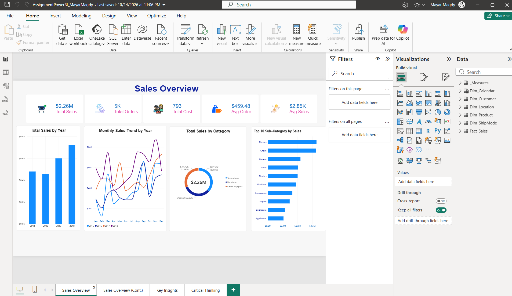
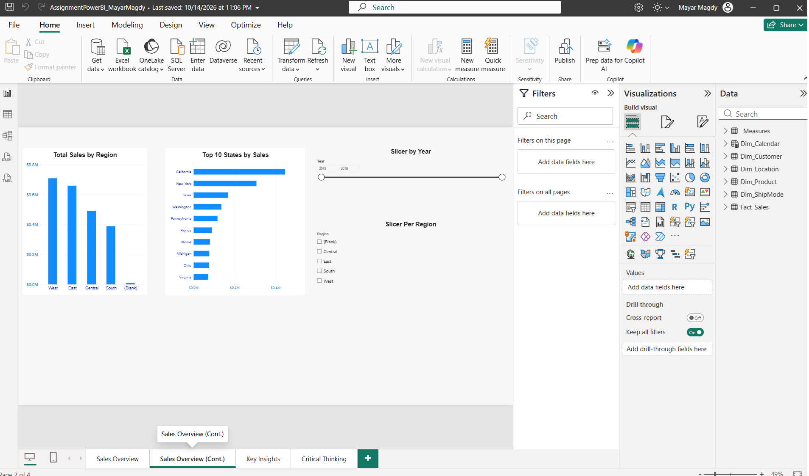
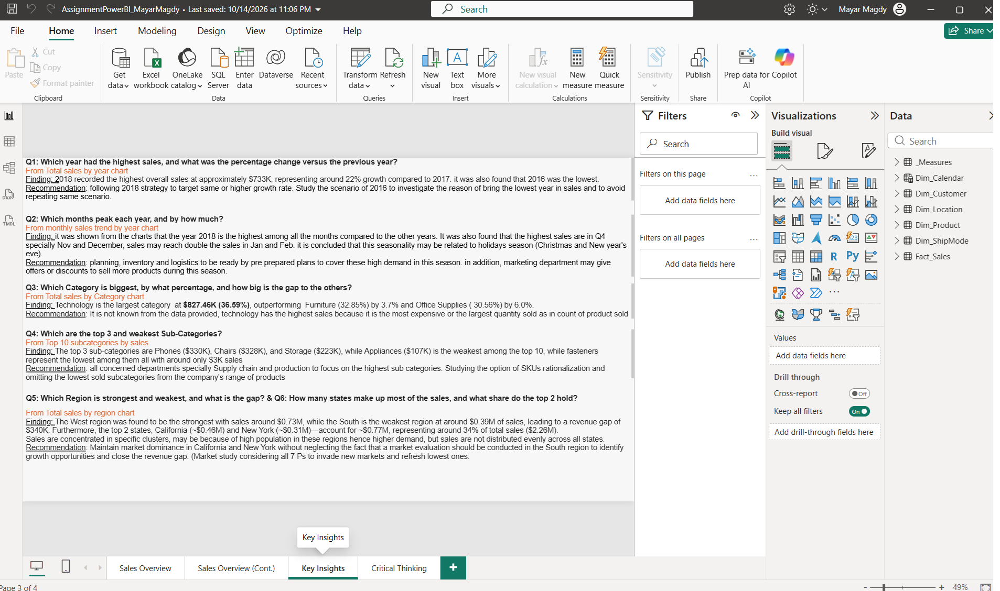
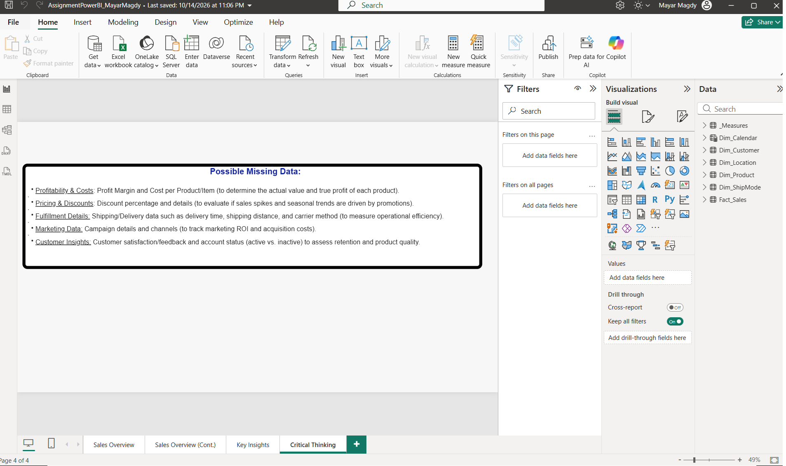

# Sales Performance Dashboard (Power BI)

An interactive 4-page Power BI report that analyzes sales performance across time, product categories, regions, and states, then turns the findings into business recommendations.

**Tool:** Power BI Desktop | **File:** `Project1-PowerBI_MayarMagdy.pbix`

---

## Business Problem

Management needed answers to six questions about sales performance:

1. Which year had the highest sales, and what was the percentage change versus the previous year?
2. Which months peak each year, and by how much?
3. Which category is biggest, by what percentage, and how big is the gap to the others?
4. Which are the top 3 and weakest sub-categories?
5. Which region is strongest and weakest, and what is the gap?
6. How many states make up most of the sales, and what share do the top 2 hold?

The report also had to include recommendations and a critical-thinking section on what data is missing.

## Dataset

Sales transaction data covering **2015 to 2018**, including orders, customers, product category and sub-category, region, and state.

| KPI | Value |
|---|---|
| Total Sales | $2.26M |
| Total Orders | ~5K |
| Total Customers | 793 |
| Average Order Value | $459.48 |
| Average Sales per Customer | $2.85K |

## Dashboard Pages

| Page | What it shows |
|---|---|
| **1. Sales Overview** | KPI cards, Total Sales by Year, Monthly Sales Trend by Year, Total Sales by Category, Top 10 Sub-Categories |
| **2. Sales Overview (Cont.)** | Total Sales by Region, Top 10 States by Sales, Year slider and Region slicer |
| **3. Key Insights** | Findings and recommendations for each business question |
| **4. Critical Thinking** | Data that is missing and would improve the analysis |

### Screenshots

## Key Insights and Recommendations

**1. Yearly growth:** 2018 was the best year at about $733K, roughly 22% growth over 2017. 2016 was the weakest year.
*Recommendation:* Aim to repeat or beat the 2018 strategy, and investigate what went wrong in 2016 to avoid repeating it.

**2. Seasonality:** Sales peak in Q4, especially November and December, reaching about double the January and February levels. This likely reflects the holiday season.
*Recommendation:* Prepare inventory and logistics ahead of Q4, and plan marketing offers or discounts for the peak season.

**3. Category performance:** Technology is the largest category at $827.46K (36.59% of sales), ahead of Furniture ($728.66K, 32.22%) and Office Supplies ($705.42K, 31.19%).
*Recommendation:* The data does not show whether Technology leads because of higher prices or higher volume. Check quantity sold to find out.

**4. Sub-categories:** The top 3 are Phones (~$330K), Chairs (~$328K), and Storage (~$223K). Appliances (~$107K) is the weakest in the top 10, and Fasteners is the lowest overall at about $3K.
*Recommendation:* Focus supply chain and production on the top sub-categories, and consider SKU rationalization for the lowest sellers.

**5. Regional performance:** West is the strongest region and South is the weakest, with a gap of about $340K.
*Recommendation:* Keep dominance in the West, and run a market study (using the 7 Ps) in the South to find growth opportunities.

**6. Geographic concentration:** California (~$0.46M) and New York (~$0.31M) together account for about $0.77M, around 34% of total sales. Sales are concentrated in a few clusters, probably due to population and demand.
*Recommendation:* Maintain market share in these two states while exploring underperforming states.

## Critical Thinking: Missing Data

- **Profitability and costs:** profit margin and cost per product, to see true profit
- **Pricing and discounts:** to tell whether spikes are driven by promotions
- **Fulfillment details:** delivery time, shipping distance, and carrier, to measure operational efficiency
- **Marketing data:** campaigns and channels, to track ROI and acquisition cost
- **Customer insights:** satisfaction, feedback, and active vs. inactive status, to assess retention

## Skills Demonstrated

- Data modeling and loading in Power BI
- KPI cards and DAX measures (total sales, orders, customers, averages)
- Choosing the right visuals: bar, line, donut, and ranked bar charts
- Interactive filtering with slicers (year range and region)
- Turning data into insights and actionable recommendations
- Identifying data gaps and limitations

## How to Open

1. Download `Project1-PowerBI_MayarMagdy.pbix`.
2. Open it in **Power BI Desktop** (free from Microsoft).
3. Use the Year and Region slicers on page 2 to explore the data.

---
*Created by Mayar Magdy | [GitHub](https://github.com/Mayar-Magdy-DA)*
