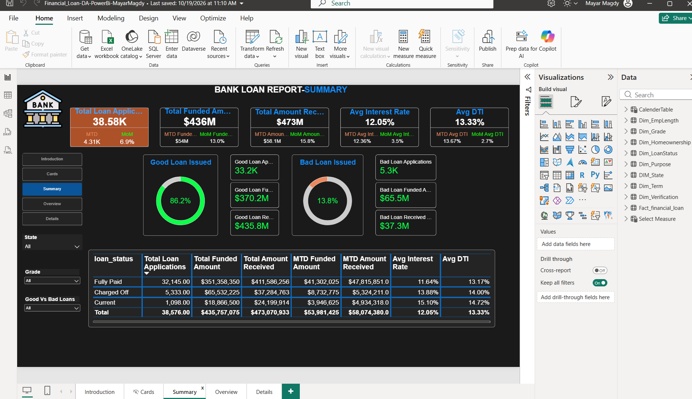
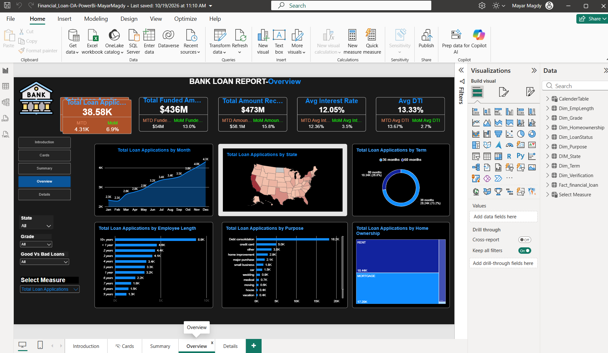
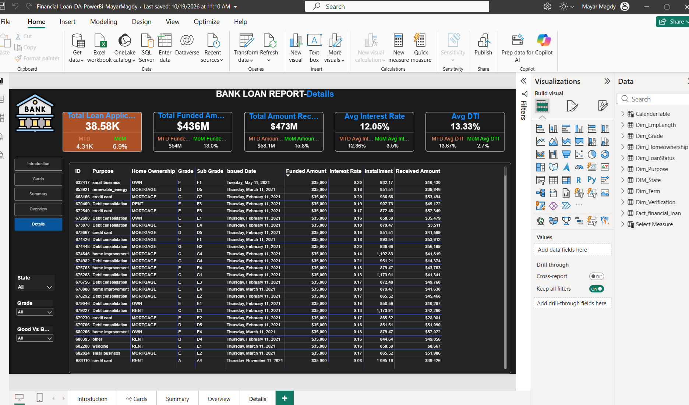

# Bank Loan Report Dashboard (Power BI)

A 5-page interactive Power BI report that monitors a bank's loan portfolio. It tracks key lending KPIs, separates **good loans** from **bad loans**, and lets users drill from portfolio-level summaries down to individual loan records.

**Tool:** Power BI Desktop | **File:** `Financial_Loan-DA-PowerBi-MayarMagdy.pbix`

---

## Business Problem

A bank needs a single view of its lending activity to answer:

- How many loans are being applied for, funded, and repaid?
- How healthy is the portfolio? What share are good loans versus bad loans?
- How do applications vary by month, state, loan term, employment length, loan purpose, and home ownership?
- How are interest rate and debt-to-income (DTI) ratio moving month over month?

## Dataset and Data Model

Loan-level data issued during **2021**, with ~38.6K loan applications. The model is a **star schema**: one fact table connected to dimension tables.

| Table | Role |
|---|---|
| `Fact_financial_loan` | Loan records: amounts, interest rate, DTI, installment, dates |
| `CalenderTable` | Date dimension for MTD and MoM calculations |
| `Dim_LoanStatus` | Fully Paid, Charged Off, Current |
| `Dim_Grade` | Loan grade |
| `Dim_Purpose` | Purpose of the loan |
| `Dim_Term` | 36 or 60 months |
| `Dim_EmpLength` | Employment length |
| `Dim_Homeownership` | Rent, mortgage, own |
| `DIM_State` | State |
| `Dim_Verification` | Income verification status |
| `Select Measure` | Lets the user switch the measure shown in the Overview charts |

## Dashboard Pages

| Page | Purpose |
|---|---|
| **Introduction** | Landing page explaining the report |
| **Cards** | KPI cards |
| **Summary** | KPIs, good vs bad loan split, and a loan-status table |
| **Overview** | Trends and breakdowns by month, state, term, employment length, purpose, and home ownership |
| **Details** | Loan-level table (ID, purpose, home ownership, grade, sub-grade, issue date, funded amount, interest rate, installment, received amount) |

All pages share **State**, **Grade**, and **Good vs Bad Loans** slicers, plus page navigation buttons. The Overview page also has a **Select Measure** slicer.

### Screenshots

## KPIs

| KPI | Value | MTD | MoM change |
|---|---|---|---|
| Total Loan Applications | 38.58K | 4.31K | +6.9% |
| Total Funded Amount | $436M | $54M | +13.0% |
| Total Amount Received | $473M | $58.1M | +15.8% |
| Average Interest Rate | 12.05% | 12.36% | +3.5% |
| Average DTI | 13.33% | 13.67% | +2.7% |

## Good Loans vs Bad Loans

- **Good loans** = Fully Paid + Current
- **Bad loans** = Charged Off

| | Good Loans | Bad Loans |
|---|---|---|
| Share of applications | **86.2%** | **13.8%** |
| Applications | 33.2K | 5.3K |
| Funded amount | $370.2M | $65.5M |
| Amount received | $435.8M | $37.3M |

## Key Insights

1. **The portfolio is healthy overall.** About 86% of loans are good, and total money received ($473M) exceeds total money funded ($436M).
2. **Bad loans lose money.** Charged-off loans received $37.3M against $65.5M funded, a shortfall of about $28.2M (roughly 57% recovered).
3. **Good loans are profitable.** They returned $435.8M on $370.2M funded, about 18% more than was lent.
4. **Riskier loans carry higher rates and DTI.** Charged-off loans average a 13.88% interest rate and 14.00% DTI, versus 11.64% and 13.17% for fully paid loans.
5. **Applications grew steadily through the year.** Monthly applications rose from about 2.3K in January to about 4.3K in December.
6. **Most loans are short-term.** 73.2% of applications are for 36-month terms, and 26.8% for 60-month terms.
7. **Debt consolidation dominates.** It accounts for about 18.2K applications, far ahead of credit card (5.0K) and other (3.8K).
8. **Applicants are mostly renters or mortgage holders** (about 18.4K and 17.2K applications respectively), and applicants with 10+ years of employment are the largest group (8.9K).

## Recommendations

- Monitor the rising interest rate and DTI month over month, since higher values are associated with charged-off loans.
- Review lending criteria for the segments where charge-offs concentrate (use the Grade and Purpose slicers to investigate).
- Plan capacity and risk monitoring for continued growth in applications.

## Skills Demonstrated

- Star-schema data modeling with fact and dimension tables
- DAX measures for MTD and MoM comparisons
- A good vs bad loan classification built from loan status
- KPI cards with conditional context (MTD and MoM)
- A field parameter ("Select Measure") for dynamic visuals
- Page navigation buttons and synced slicers
- Map, area, donut, bar, and treemap visuals
- A drill-down detail table for loan-level analysis

## How to Open

1. Download `Financial_Loan-DA-PowerBi-MayarMagdy.pbix`.
2. Open it in **Power BI Desktop** (free from Microsoft).
3. Use the buttons on the left to move between pages, and the slicers to filter by state, grade, or good/bad loans.

---
*Created by Mayar Magdy | [GitHub](https://github.com/Mayar-Magdy-DA)*
